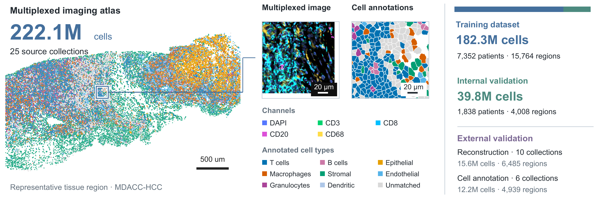
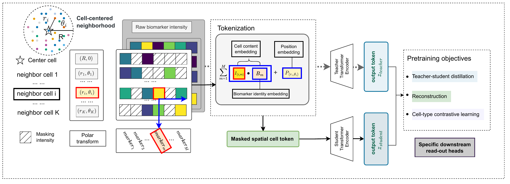

# SOBER

**Molecular–spatial representation learning from multiplexed protein imaging.**

**SOBER (Spatial Omics Biomarker Encoder)** is a cell-centered transformer that jointly represents protein expression and local tissue context. It combines intensity-weighted marker embeddings with center-relative positional encodings to represent each cell together with its spatial neighbors. Masked protein reconstruction predicts hidden center-cell intensities from visible markers and surrounding cells.

## Overview



The development atlas contains **222.1 million cells across 25 source collections**, partitioned by patient into 182.3 million cells for training and 39.8 million for internal validation.



Default training in this release combines **masked protein reconstruction (1.0)** and **study-aware coarse cell-type InfoNCE (0.2)**. Exponential-moving-average (EMA) teacher–student distillation is optional. Downstream evaluation code is outside this release.

## Installation

Use a Python 3.10+ environment. GPU training requires a CUDA-enabled PyTorch installation.

```bash
python -m pip install -r requirements.txt
```

The [data loading tutorial](tutorials/data_loading.ipynb) covers real tables, normalization, and spatial neighborhoods using one internal training region (UPMC-HNC) and two external regions (Damond and Meyer). See [example data](examples/data/README.md) for their sources and split membership.

## Input data

Provide one folder per study, containing one folder per tissue region:

```text
CellularTables/
├── study_A/
│   ├── region_001/
│   │   ├── cell_data.csv
│   │   ├── expression.csv
│   │   └── cell_type.csv       # needed only for label supervision
│   └── region_002/
│       └── ...
└── study_B/
    └── region_003/
        └── ...
```

| File | Required columns | Meaning |
| --- | --- | --- |
| `cell_data.csv` | `cell_id,x,y` | Cell identifiers and spatial coordinates |
| `expression.csv` | `cell_id,<marker_1>,<marker_2>,...` | Raw, non-negative protein marker intensities |
| `cell_type.csv` | `cell_id,cell_type` | Optional cell-type annotations |

Use consistent coordinate units across studies. Within each region, cell IDs must be unique and match between coordinate and expression tables. The loader normalizes raw intensities separately for each region and marker.

For patient splitting, supply a CSV with `ACQUISITION_ID` (region folder name) and `PATIENT_ID`. The default split assigns 80% of patients to training and 20% to internal validation, with seed 42.

## Training

Run from the repository root:

```bash
python train.py \
  --data-root /path/to/CellularTables \
  --patient-metadata /path/to/patients.csv \
  --config configs/current.json \
  --save-dir checkpoints/sober \
  --device cuda:0 \
  --epochs 10 \
  --batch-size 128
```
